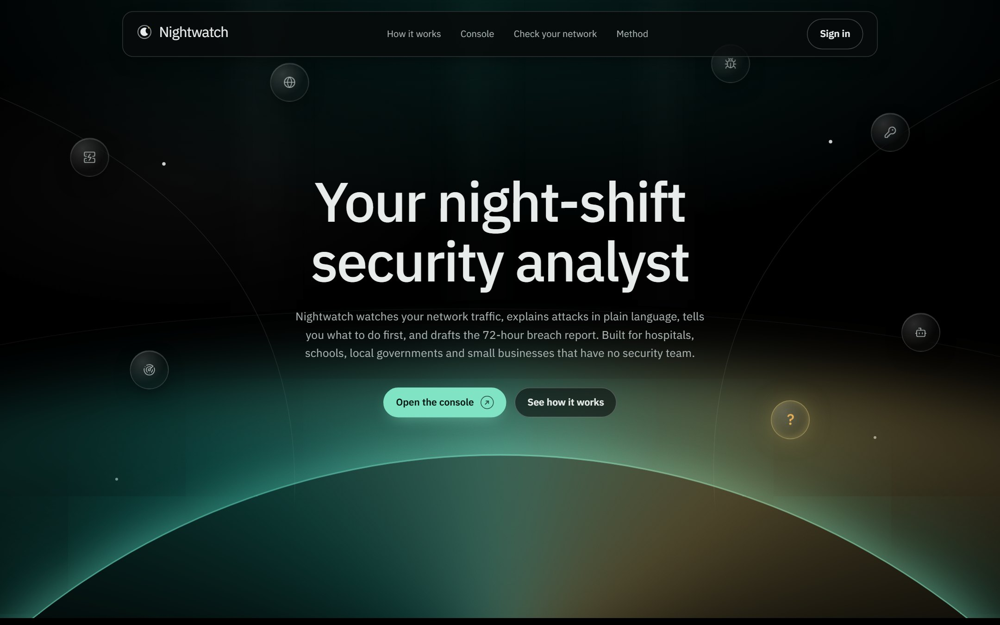
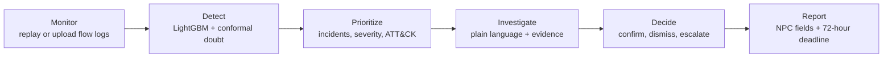
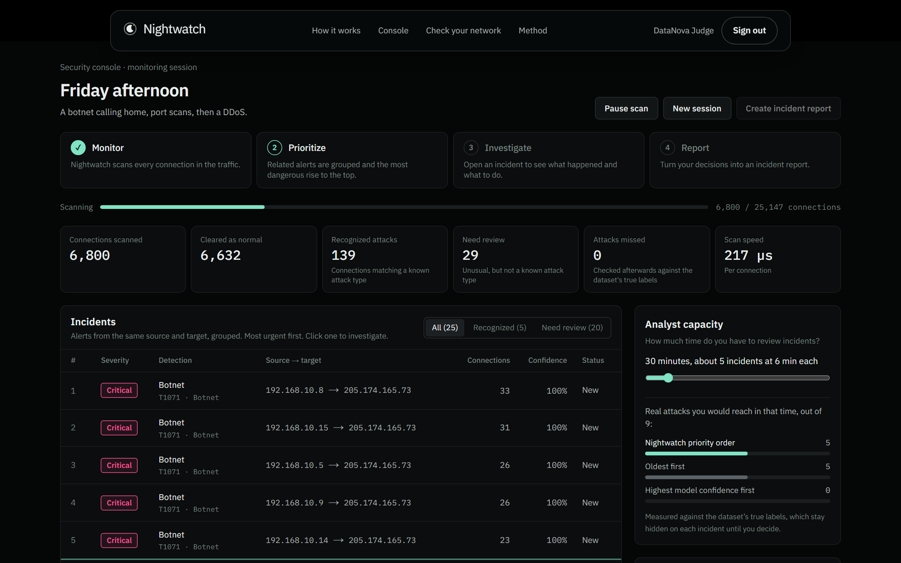
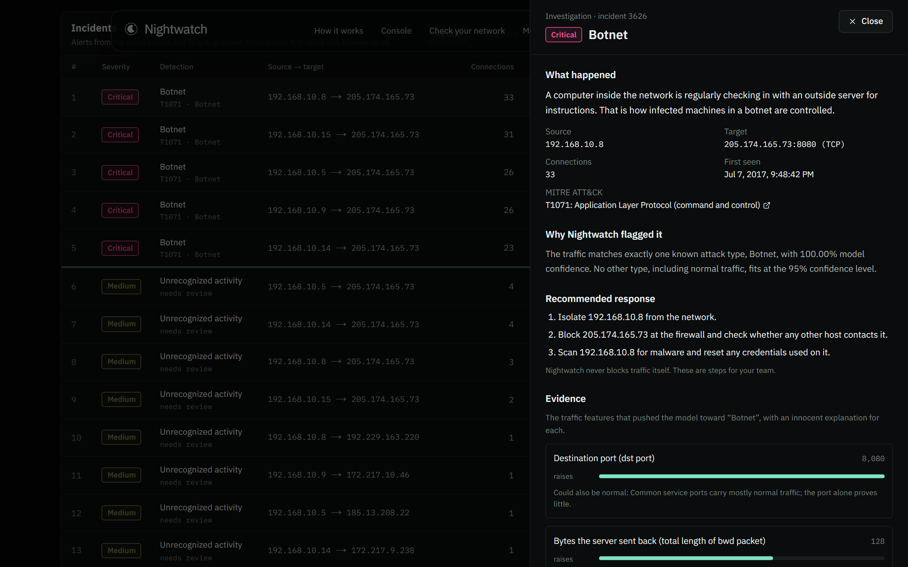
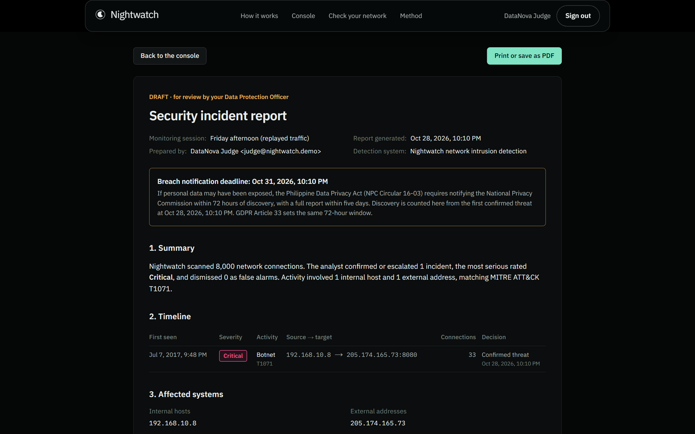
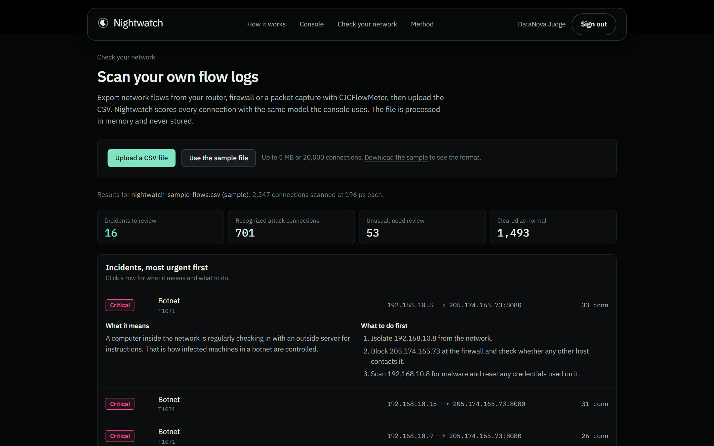
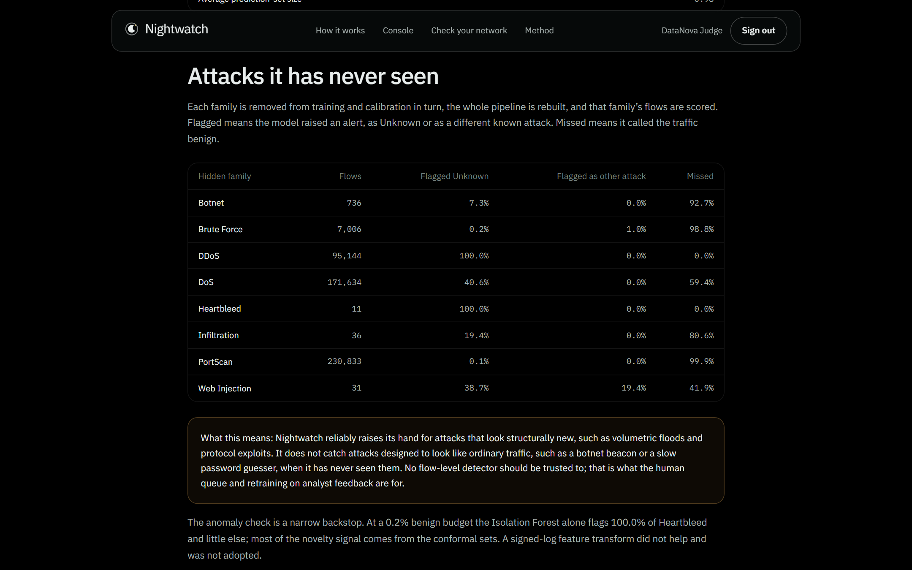

# NIGHTWATCH

**Your night-shift security analyst: network intrusion detection that explains every alert in plain language, ranks what to fix first, and drafts the 72-hour breach report, for organizations that have no security team.**

[](https://nextjs.org/)
[](https://www.typescriptlang.org/)
[](https://www.python.org/)
[](https://lightgbm.readthedocs.io/)
[](https://neon.com/)
[](https://nightwatch-olive.vercel.app/)
[](https://datanova-2026-global-data-thon.devpost.com/)

**DataNova 2026 Global Data-thon** submission, track **Cybersecurity and Fraud Detection, DN-CY-01: Network Intrusion Detection with Imbalanced Threat Data** (build window Oct 28 to Nov 10, 2026).

<p align="center">
  
</p>

---

## Overview

In September 2023, the Medusa ransomware group hit PhilHealth. About **13 million** members' records were reported leaked, and its antivirus licence had lapsed months earlier. The Philippine Data Privacy Act still gives an organization **72 hours** to notify the National Privacy Commission after it discovers a breach.

Provincial hospitals, schools, local governments and small businesses face the same attackers with no 24-hour security team. Commercial security operations centers are priced for banks, and machine-learning detectors that score 99% in the lab bury the one IT person in false alarms.

**NIGHTWATCH** does the analyst's night shift in five steps:

1. **Monitor:** reads network flow logs (CICFlowMeter format) from a live replay or an uploaded file.
2. **Detect:** a LightGBM model trained on the *corrected* CIC-IDS2017 names the attack, or says it does not recognize it.
3. **Prioritize:** groups alerts into incidents and ranks them Critical, High, Medium or Low, with the MITRE ATT&CK technique.
4. **Investigate:** explains each incident in plain words, with the evidence and an innocent explanation beside every signal.
5. **Report:** turns confirmed incidents into a draft breach report with the NPC's four notification fields and the 72-hour deadline.

It never blocks traffic on its own. It tells a person what happened, how sure it is, and what to do first; the person decides.

> Your team goes home. Nightwatch stays on.

---

## Try it now

**Live demo:** [https://nightwatch-olive.vercel.app](https://nightwatch-olive.vercel.app/)

On the sign-in page, press **Use the judge demo account**. No sign-up needed.

| Surface | URL |
| --- | --- |
| Landing | [`/`](https://nightwatch-olive.vercel.app/) |
| Security console (replay a held-out day) | [`/console`](https://nightwatch-olive.vercel.app/console) |
| Check your network (upload flow logs) | [`/check`](https://nightwatch-olive.vercel.app/check) |
| Method (every number, every limit) | [`/method`](https://nightwatch-olive.vercel.app/method) |

A sample flow file is one click away on *Check your network*.

---

## What makes this different

### 1. It says "I'm not sure" instead of staying silent

A normal classifier must pick a label, so an attack it has never seen is quietly called normal. NIGHTWATCH wraps the model in **Mondrian split-conformal prediction**: it lists every label it cannot rule out at 95% confidence.

| Verdict | Meaning |
| --- | --- |
| Recognized attack | Exactly one attack type fits |
| Needs review | Neither a known attack nor normal; never silently dropped |
| Cleared | Only normal traffic fits |

On held-out test traffic (393,993 flows):

| Measure | Value |
| --- | ---: |
| Attack flows that raised an alert | **99.96%** |
| Normal flows that raised a false alert | **0.42%** |
| Attack flows missed | **0.039%** |
| Macro-F1 over attack classes | **0.865** |

### 2. Honest evaluation, including what it misses

- **Corrected data.** More than 25% of flows in the original CIC-IDS2017 were mislabeled or broken (Engelen et al. 2021; Liu et al. 2022). NIGHTWATCH trains on the corrected release.
- **Split by time, not shuffled.** A random split scores 99.99% accuracy because neighbouring flows of one attack leak into training. Attacks are split chronologically inside each campaign; normal traffic in whole 15-minute blocks.
- **Not just reading ports.** Retrained without destination port and protocol, macro-F1 goes from 0.865 to 0.868.
- **The unseen-attack test.** Each attack family is removed from training in turn and the pipeline rebuilt. DDoS and Heartbleed are still flagged **100%** of the time; botnet, brute-force and port-scan traffic, which imitates normal traffic, mostly passes. This is shown on the Method page, not hidden.

### 3. Built around the analyst's time and the law's clock

| Evidence | Detail |
| --- | --- |
| Alert flood to a short list | Five replayed days: **102,268** alerts grouped into **471** incidents |
| Priority that holds | Reviewing 10 incidents a day reaches **19 of 22** real attack incidents (oldest-first: 16; model confidence alone: 1) |
| Plain language | Every incident: what happened, the ATT&CK technique, evidence with an innocent explanation, first response steps |
| Breach report | Draft with the NPC Circular 16-03 fields, timeline, affected hosts and the 72-hour deadline, marked for the Data Protection Officer |

---

## Product flow



| Route | Purpose |
| --- | --- |
| `/` | The problem, the workflow, results and limits |
| `/console` | Replay a held-out day; incidents stream in, ranked, with an analyst-capacity line |
| `/reports/:session` | Draft incident report from the analyst's decisions; print or save as PDF |
| `/check` | Score an uploaded CICFlowMeter CSV in memory (never stored) |
| `/method` | Data, splits, ablations, conformal coverage, unseen-attack test, the ten pitfalls, sources |

---

## Screenshots

Live product captures from [nightwatch-olive.vercel.app](https://nightwatch-olive.vercel.app/).

<table>
<tr>
<td width="50%" valign="top">

<strong>1. Security console</strong><br/>
<br/>
<sub>Held-out traffic scored live; botnet command traffic ranked Critical at the top.</sub>

</td>
<td width="50%" valign="top">

<strong>2. Investigate</strong><br/>
<br/>
<sub>What happened, why it was flagged, what to do first, and the evidence.</sub>

</td>
</tr>
<tr>
<td width="50%" valign="top">

<strong>3. Incident report</strong><br/>
<br/>
<sub>Draft for the Data Protection Officer, with the deadline worked out.</sub>

</td>
<td width="50%" valign="top">

<strong>4. Check your network</strong><br/>
<br/>
<sub>Your own flow export, scored by the same model, in memory.</sub>

</td>
</tr>
<tr>
<td colspan="2" valign="top">

<strong>5. Method: attacks it has never seen</strong><br/>
<br/>
<sub>Every limit is on the page, including the families it misses.</sub>

</td>
</tr>
</table>

Regenerate the screenshots:

```bash
NODE_PATH=video/node_modules node docs/capture-readme-shots.mjs
```

---

## Built like a real product, not a notebook

| Evidence | Detail |
| --- | --- |
| **Model in the web app** | LightGBM trees, TreeSHAP and the conformal layer re-implemented in TypeScript; matches Python to within 0.000001 on 901 test flows (parity test) |
| **No Python server** | Scoring runs inside Next.js route handlers on Vercel (`sin1`), next to Neon in Singapore |
| **Real accounts** | Neon Auth (Managed Better Auth); every data route checks the signed-in user on the server |
| **Secure by default** | Rate limits, append-only audit log of analyst decisions, uploads scored in memory and never stored, strict security headers, safe post-login redirects |
| **Tested** | 28 Python tests (labels, splits, conformal coverage), 14 web tests (scoring parity, CSV parsing, ranking, redirects) |
| **Fast and accessible** | Lighthouse on the live site (Oct 28, 2026): desktop 100 in all four categories; mobile performance 98 to 99 with accessibility, best practices and SEO at 100 |

---

## Tech stack

| Layer | From the repo |
| --- | --- |
| ML pipeline | Python 3.12 (uv), pandas, LightGBM, scikit-learn, imbalanced-learn, SHAP |
| Scoring | TypeScript: tree evaluation, path-dependent TreeSHAP, Isolation Forest, Mondrian conformal |
| Web | Next.js 16 (App Router, Turbopack), React 19, Tailwind CSS 4, IBM Plex |
| Data and auth | Neon Postgres with Drizzle ORM, Neon Auth |
| Deploy | Vercel, functions pinned to `sin1` |
| Presentation | `deck/` generator (pptxgenjs) reads every number from `ml/reports/` |

---

## Run it locally

```bash
git clone https://github.com/yuan05-afk/nightwatch.git
cd nightwatch/web
cp .env.example .env.local   # Neon DATABASE_URL, NEON_AUTH_BASE_URL, NEON_AUTH_COOKIE_SECRET
npm install
npm run dev
```

### Rebuild the model and reports (optional)

```bash
cd ml
uv sync
# place the corrected CIC-IDS2017 CSVs (DistriNet, CNS 2022) under ml/data/raw/
uv run python -m nightwatch_ml.pipeline        # ablation, final, illusion, zero_day, no_port
uv run python -m nightwatch_ml.export model     # writes web/lib/scoring/model/
uv run python -m nightwatch_ml.sync_reports     # copies reports into the web app
uv run pytest
```

### Docs in this repo

- [docs/METHOD.md](./docs/METHOD.md): data, label policy, splits, metrics, ablations
- [docs/RESEARCH.md](./docs/RESEARCH.md): every claim and its source
- [deck/](./deck): the presentation and its generator

---

## Responsible use

- **Human in the loop.** No automatic blocking; every action is a recommendation.
- **Uncertainty shown.** Doubtful traffic goes to *Needs review* with its reason, never silently cleared.
- **Limits disclosed.** Trained on one public lab dataset from 2017; attacks that imitate normal traffic can slip through.
- **Reports are drafts.** The breach report is for the organization's Data Protection Officer to review; it is not legal advice.
- **Privacy.** Uploaded logs are processed in memory and never stored; IP addresses are hashed in the audit log.

**Data and licences:** corrected CIC-IDS2017 (Liu, Engelen, Lynar, Essam, Joosen, IEEE CNS 2022; original by Sharafaldin, Lashkari, Ghorbani, UNB CIC, 2018). MITRE ATT&CK® is a registered trademark of The MITRE Corporation.

---

## What's next

1. Test on the corrected CSE-CIC-IDS2018 for drift across years.
2. Learn from analyst decisions to cut repeat false alarms at each site.
3. Tune the false-alert budget per organization.
4. Pilot with a school or local government office in the Philippines.

---

_Built by [Yuan Andrei Mariano](https://github.com/yuan05-afk). Open the [live demo](https://nightwatch-olive.vercel.app/), press **Use the judge demo account**, start the Friday replay, and open the first Critical incident._
